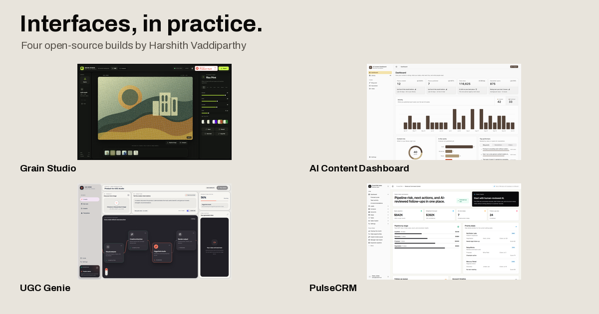

# UI Gallery

Implemented interfaces by [Harshith Vaddiparthy](https://www.harshith.com), AI consultant and product builder.

**[Explore the gallery →](https://www.harshith.com/ui)**



Real application screenshots, practical design notes, working previews and links to the original code. This repository contains the runnable gallery. Each featured application lives in its own source repository.

## Run locally

Requires Node.js 22.12+ and npm. No account, API key or database is needed to run the gallery.

```sh
git clone https://github.com/harshith-vaddiparthy/ui-gallery.git
cd ui-gallery
npm ci
npm run dev
```

Open the loopback URL Vite prints. For a production build, run `npm run build`, then `npm run preview`.

## Interface studies

- [Grain Studio](docs/grain-studio.md) — a browser image editor with a tactile effect dock and before/after comparison.
- [AI Content Dashboard](docs/ai-content-dashboard.md) — a content workspace joining overview, library and drafting flows.
- [UGC Genie](docs/ugc-genie.md) — a visible, staged workflow for product-video production.
- [PulseCRM](docs/pulse-crm.md) — pipeline, relationship and next-action views using bundled demo records.

Screenshots show actual implementations. Each caption states the sample/demo context. A screenshot is not a claim about customer adoption or production outcomes. Application previews may require their own configuration; follow the individual source README.

## Structure

```text
src/components/UiGallery.jsx   Gallery and screen selection
src/data/uiProjects.js         Public catalog, source revisions and credits
src/styles/ui-gallery.css      Scoped gallery styles
public/ui-media/               Real screenshots and optimized web images
docs/                         Per-project studies
scripts/validate.mjs           Catalog and media checks
```

The canonical website imports a verified revision of the gallery component, catalog, styles and media. Its normal build generates route metadata, a sitemap entry and a no-JavaScript reading version. The source catalog is the place to add or revise a study.

## Add a study

1. Verify ownership, original contribution and source license. A fork or public repository alone is not evidence of authorship or an open-source license.
2. Run a safe local/demo instance. Never photograph customer records, credentials or internal account details.
3. Capture real screens, retain the original aspect ratio, and document the source revision, capture date and demo mode. Add optimized media without changing the interface.
4. Add a catalog record and a short case study explaining actual design choices and the foundation used.
5. Run `npm run check` and `npm run build`. Inspect desktop and narrow-phone layouts, category filtering, screen selection and full-size image links.

Do not copy private repositories into this collection. Do not add unsupported performance claims, fake user counts, invented screenshots or third-party designs presented as original work.

## License and credits

Gallery code and original documentation: [MIT](LICENSE). Featured projects retain their own licenses, pinned in each study. Component libraries, visual references, trademarks and media are credited in [THIRD_PARTY_NOTICES.md](THIRD_PARTY_NOTICES.md). The gallery license does not relicense upstream projects or grant trademark rights.
