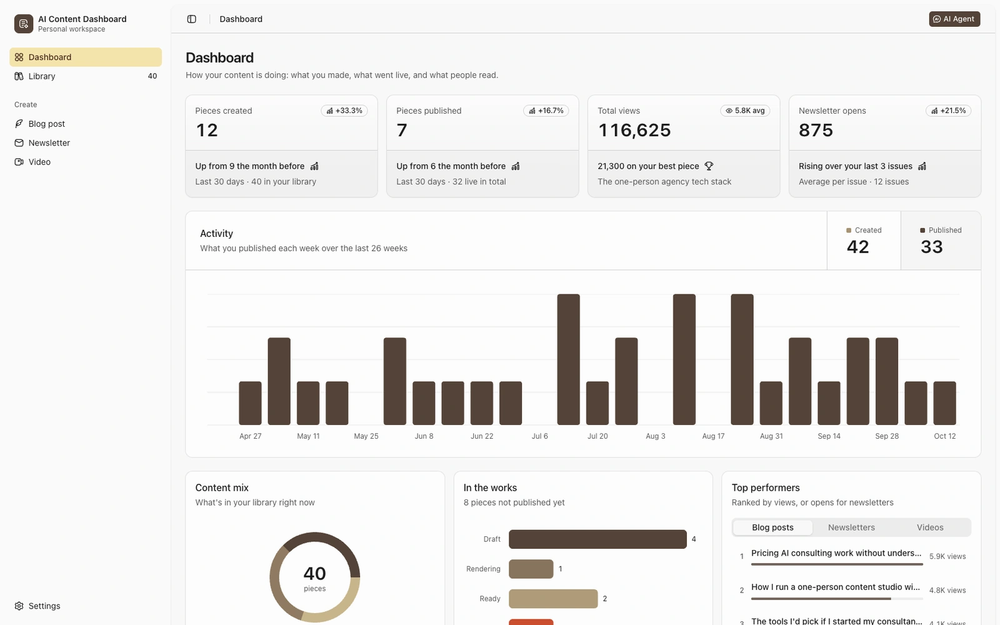
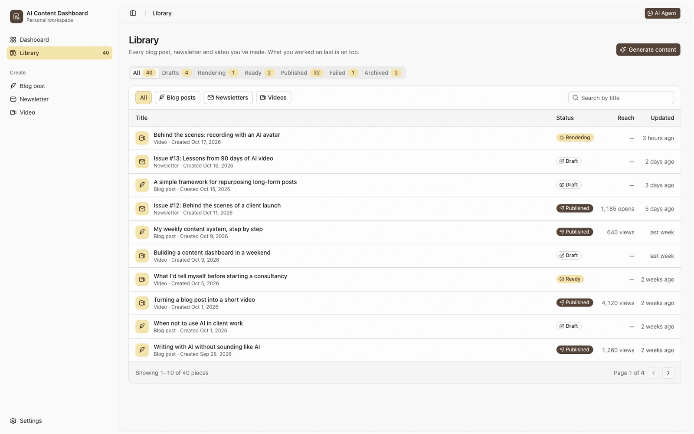
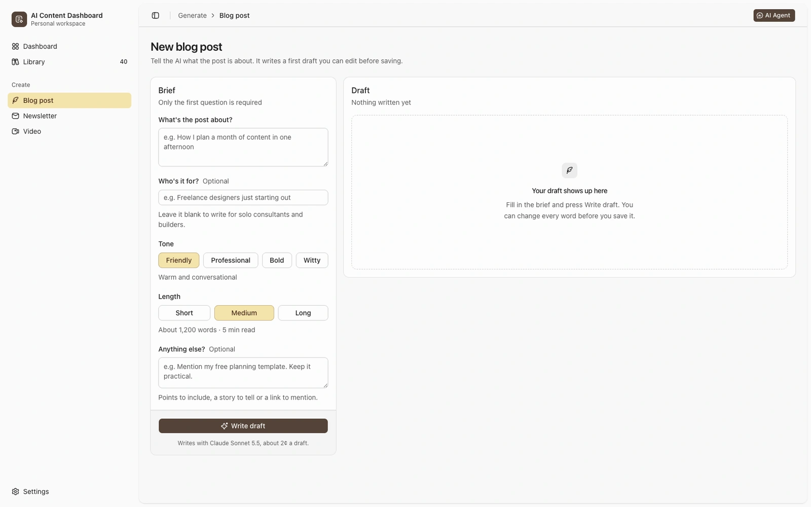
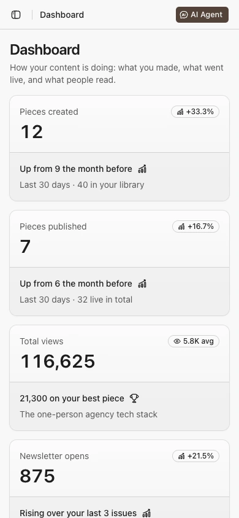

# AI Content Dashboard

A workspace for planning, generating and organizing content, with one shared model behind its library, metrics and charts.

## Source and license

- Source: [ai-content-dashboard](https://github.com/harshith-vaddiparthy/ai-content-dashboard)
- Audited revision: [`fa0f1a0b64785f34d51f8caae5ef6aab8768ade4`](https://github.com/harshith-vaddiparthy/ai-content-dashboard/commit/fa0f1a0b64785f34d51f8caae5ef6aab8768ade4)
- Project license: [MIT at the audited revision](https://github.com/harshith-vaddiparthy/ai-content-dashboard/blob/fa0f1a0b64785f34d51f8caae5ef6aab8768ade4/LICENSE)
- Copyright notice in that license: 2026 Harshith Vaddiparthy.

Content workflow and interface composition by Harshith Vaddiparthy, built on shadcn/ui, Base UI, Hugeicons and the tweakcn Caffeine theme.

## Design decisions

- Separate creation, the content library and settings with a flat sidebar and consistent page headers.
- Connect summary metrics, activity charts and recent content to the same sample-content model.
- Reuse content rows and type/status labels across the overview and library.

## Foundations

The interface uses shadcn/ui, Base UI and Hugeicons. The project adds its application navigation, content library, charts, generation screens and shared content model.

Underlying packages, icons and other third-party assets retain their own licenses and attribution. The gallery MIT license does not replace them.

## Safe local preview

Use a current Node.js LTS supported by the project. The repository includes package-lock.json.

Run the source in a fresh checkout. Use sample files and demo data when sharing screenshots.

```bash
git clone https://github.com/harshith-vaddiparthy/ai-content-dashboard.git
cd ai-content-dashboard
git checkout fa0f1a0b64785f34d51f8caae5ef6aab8768ade4
npm ci
npm run dev
```

Open `/dashboard` and inspect the existing sample content. Do not configure provider credentials or invoke content/video generation for a screenshot preview. At this source revision, `lib/db/content.ts` hardcodes `USING_SAMPLE_DATA = true` and seeds the in-memory store with `createSampleContent`. Edits can change that running store, so a fresh preview is the reproducible sample state. The sample metrics are not Harshith’s business results.

## Capture context

Gallery captures must identify their source revision, capture date and whether example or simulated data is shown. Only reviewed application imagery belongs in this case. Source links remain pinned above so the design can be inspected independently.

Public preview: [Open the sample dashboard](https://ai-content-dashboard-murex.vercel.app/dashboard)

<!-- gallery-captures -->
## Screens

Fictional sample content; metrics are illustrative. Capture dates and source verification are recorded in the [capture manifest](../public/ui-media/capture-manifest.json).

### Content overview



[Open the original screenshot](../public/ui-media/ai-content-dashboard-overview-desktop.png)

### Content library



[Open the original screenshot](../public/ui-media/ai-content-dashboard-library-desktop.png)

### Brief to draft workspace



[Open the original screenshot](../public/ui-media/ai-content-dashboard-brief-desktop.png)

### Phone overview



[Open the original screenshot](../public/ui-media/ai-content-dashboard-overview-mobile.png)
