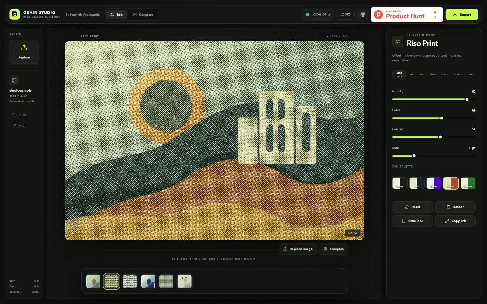
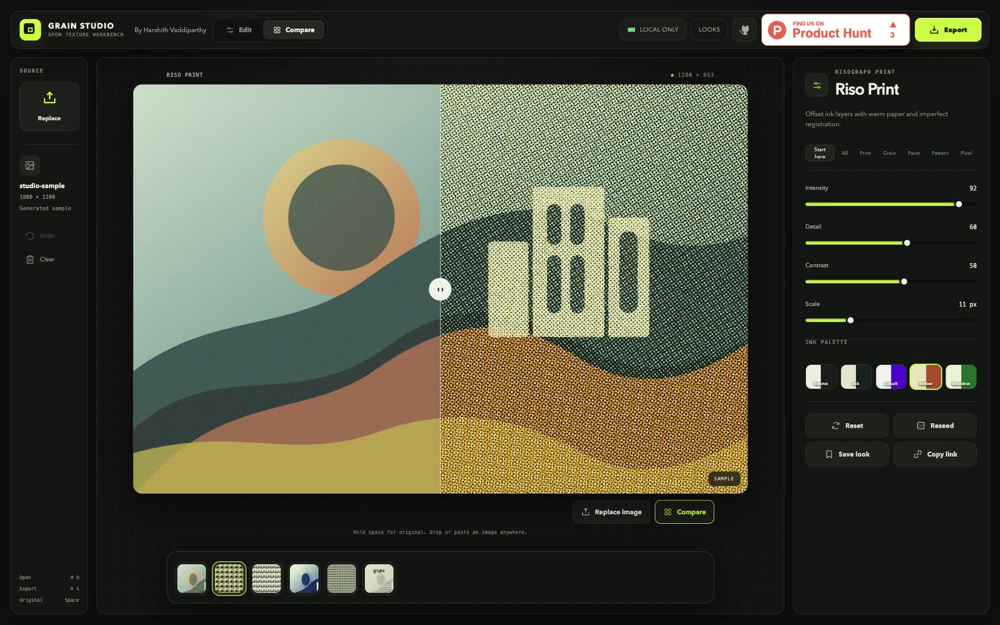
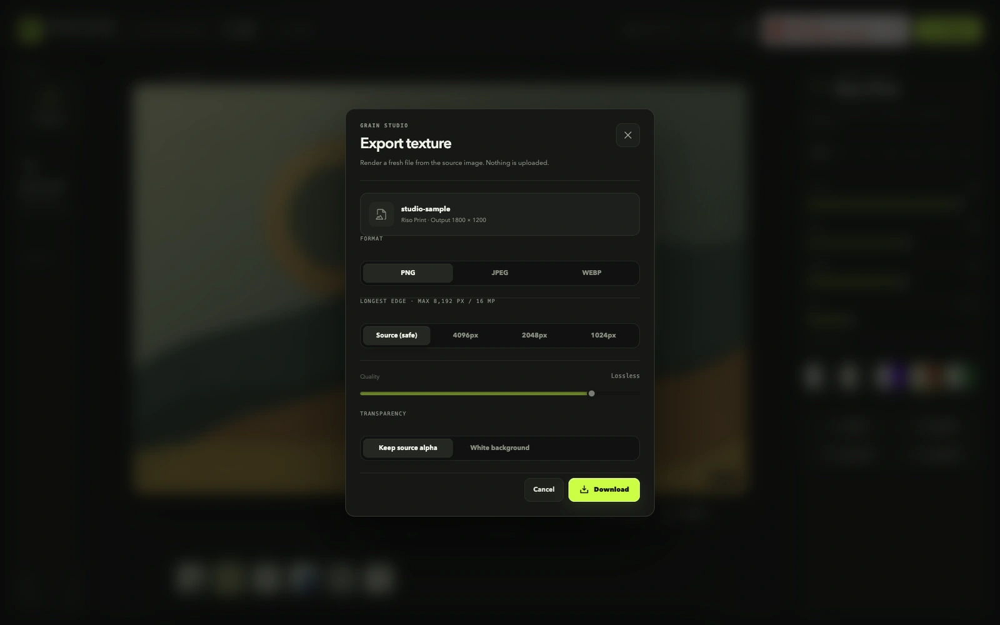
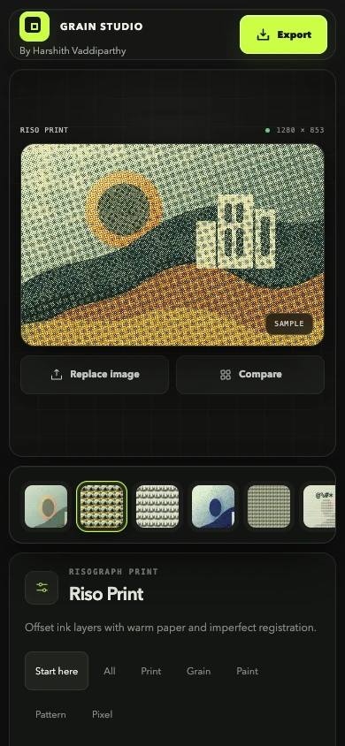

# Grain Studio

A local-first image texture workbench with a before-and-after canvas, material controls and deliberate export options.

## Source and license

- Source: [grain-studio](https://github.com/harshith-vaddiparthy/grain-studio)
- Audited revision: [`1efb17c2f33c5e2a3e11ab01293633725ae7a2dc`](https://github.com/harshith-vaddiparthy/grain-studio/commit/1efb17c2f33c5e2a3e11ab01293633725ae7a2dc)
- Project license: [MIT at the audited revision](https://github.com/harshith-vaddiparthy/grain-studio/blob/1efb17c2f33c5e2a3e11ab01293633725ae7a2dc/LICENSE)
- Copyright notice in that license: 2026 Harshith Vaddiparthy.

Application design and implementation by Harshith Vaddiparthy. Behavior was independently implemented after studying Textures; the tactile dock is informed by ThreeUI Community. React, Vite and Phosphor Icons provide the runtime foundations.

## Design decisions

- Keep effect selection, the comparison canvas and parameter controls in one editing workspace.
- Use a before-and-after scrubber to compare a texture with the original image.
- Make export visible through format, size, progress and cancellation states.

## Foundations

React, Vite and Phosphor Icons provide the application and icon foundations. The canvas, inspector, comparison and export workflow are the application work highlighted here.

Underlying packages, icons and other third-party assets retain their own licenses and attribution. The gallery MIT license does not replace them.

## Safe local preview

The source package pins pnpm 10.33.0. Use a Node.js version supported by the project’s Vite release.

Run the source in a fresh checkout. Use sample files and demo data when sharing screenshots.

```bash
git clone https://github.com/harshith-vaddiparthy/grain-studio.git
cd grain-studio
git checkout 1efb17c2f33c5e2a3e11ab01293633725ae7a2dc
pnpm install --frozen-lockfile
pnpm dev
```

Use a harmless sample image that you are allowed to share. The editor processes images in the browser; a screenshot should not expose a personal photo library or unrelated files.

## Capture context

Gallery captures must identify their source revision, capture date and whether example or simulated data is shown. Only reviewed application imagery belongs in this case. Source links remain pinned above so the design can be inspected independently.

Public preview: [Open the image editor](https://grainstudio.harshith.com/)

<!-- gallery-captures -->
## Screens

Included studio sample artwork. Capture dates and source verification are recorded in the [capture manifest](../public/ui-media/capture-manifest.json).

### Texture workbench



[Open the original screenshot](../public/ui-media/grain-studio-editor-desktop.png)

### Original and texture comparison



[Open the original screenshot](../public/ui-media/grain-studio-compare-desktop.png)

### Export controls



[Open the original screenshot](../public/ui-media/grain-studio-export-desktop.png)

### Phone editor



[Open the original screenshot](../public/ui-media/grain-studio-editor-mobile.png)
