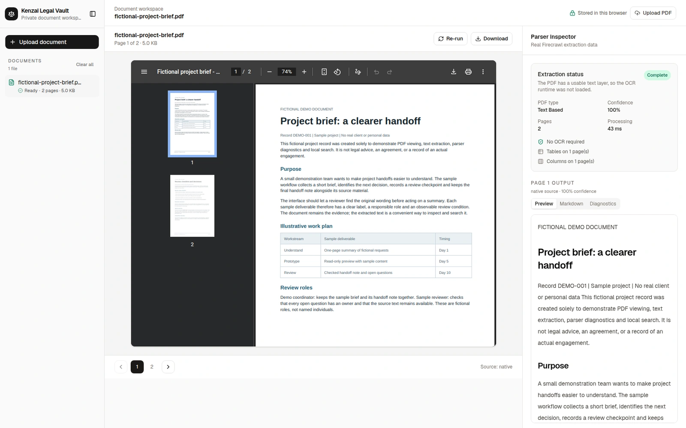
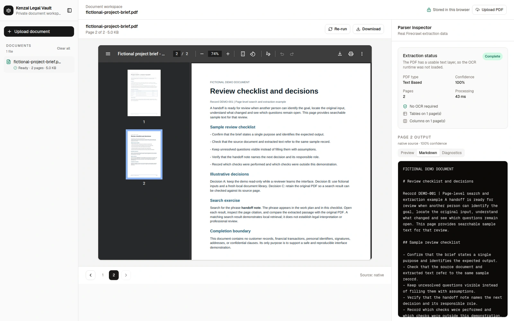
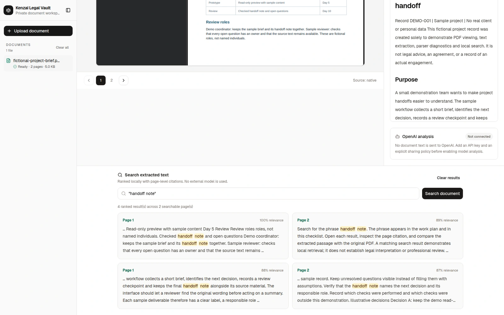
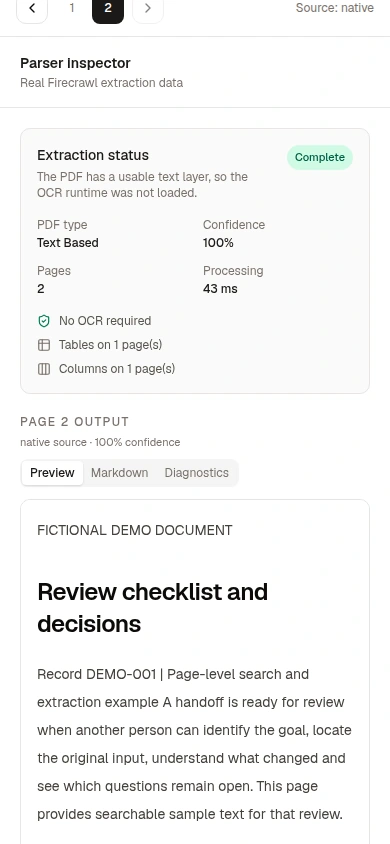

# Kenzai Legal Vault

A PDF-inspection workspace that keeps original pages beside extraction, diagnostics and cited search results.

## Source and credits

Document-workflow interface by Harshith Vaddiparthy. shadcn/Base UI provides the components, the browser displays the PDF, and Firecrawl PDF Inspector provides the parsing engine.

[Captured source revision](https://github.com/harshith-vaddiparthy/kenzai-legal-vault/tree/ba0d2104c0cdf376085fae60e6601127d18ccb35) · [MIT license](https://github.com/harshith-vaddiparthy/kenzai-legal-vault/blob/ba0d2104c0cdf376085fae60e6601127d18ccb35/LICENSE)

## Design decisions

- Keep the source PDF beside extracted text so the reader can compare them.
- Expose page-level native/OCR status and diagnostics alongside the output.
- Link local search snippets back to their source-page citations.

## Capture context

Fictional native-text PDF, processed and searched locally.

A fresh local library processed the [fictional two-page brief](fixtures/fictional-project-brief.pdf) through the actual application upload route. Both pages were native text; local phrase search returned source-page citations. No hosted model was called.

The source revision includes a one-line font-token correction and was rebuilt before capture. The captured parser version was 1.16.0. Follow the source README and native dependency requirements when setting up the application.

Compare extraction against the original: processing completion does not guarantee perfect table/layout recovery. This example demonstrates native-text parsing and local search; scanned-document OCR and legal interpretation were not evaluated.

## Screens

### Source PDF and parser output

[Original PNG](../public/ui-media/legal-vault-source-view-desktop.png)

### Page-level Markdown

[Original PNG](../public/ui-media/legal-vault-extracted-text-desktop.png)

### Local phrase search

[Original PNG](../public/ui-media/legal-vault-local-search-desktop.png)

### Phone reading view

[Original PNG](../public/ui-media/legal-vault-extracted-text-mobile.png)
