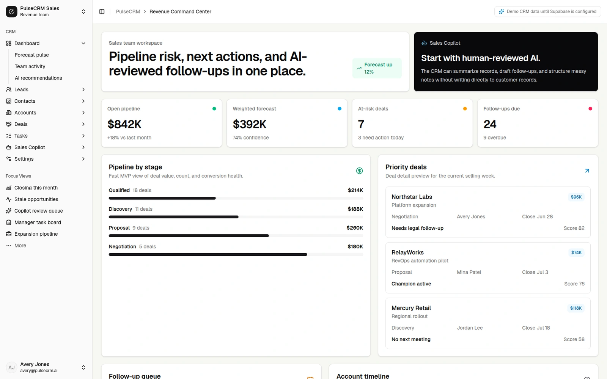
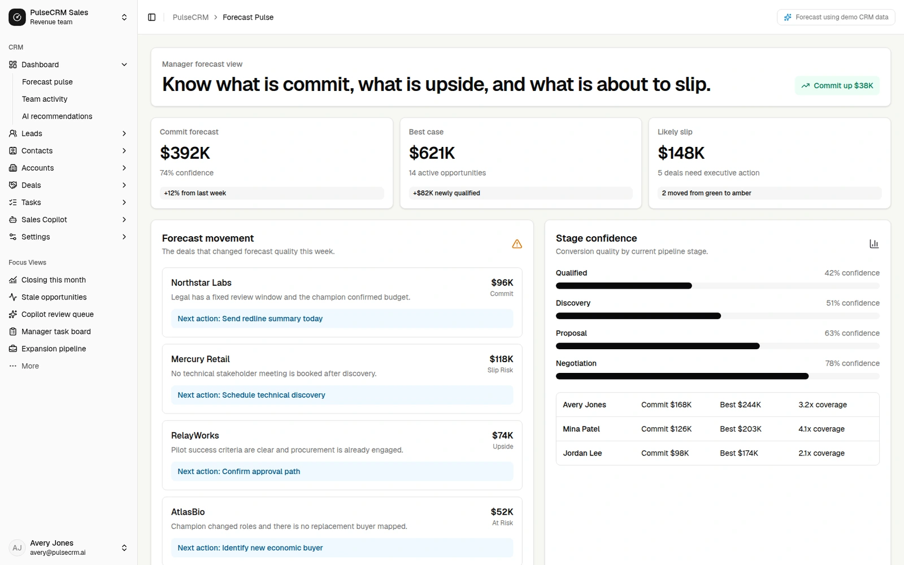
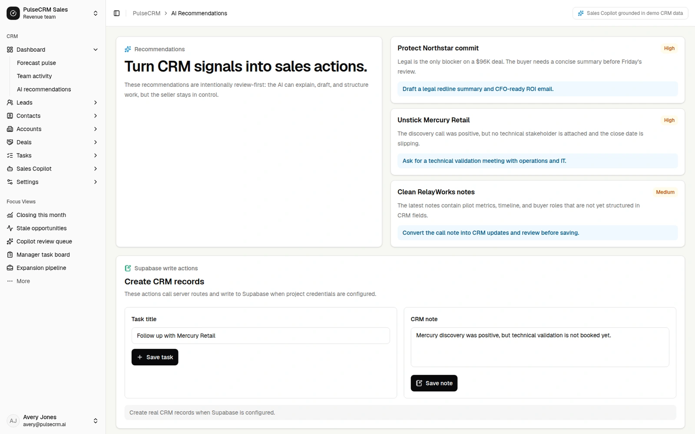
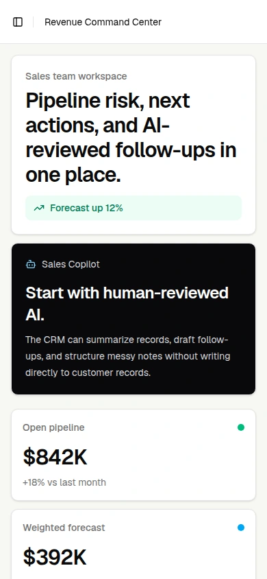

# PulseCRM

A sales workspace that brings pipeline health, priority deals, next actions and account activity into one reviewable view.

## Source and license

- Source: [gen-ai-bootcamp-crm](https://github.com/harshith-vaddiparthy/gen-ai-bootcamp-crm)
- Audited revision: [`007a6ca08158b052419b73c32432cb0108401ed7`](https://github.com/harshith-vaddiparthy/gen-ai-bootcamp-crm/commit/007a6ca08158b052419b73c32432cb0108401ed7)
- Project license: [MIT at the audited revision](https://github.com/harshith-vaddiparthy/gen-ai-bootcamp-crm/blob/007a6ca08158b052419b73c32432cb0108401ed7/LICENSE)
- Copyright notice in that license: 2026 Harshith Vaddiparthy.

CRM application and workflow customization by Harshith Vaddiparthy; the navigation shell adapts shadcn/ui’s sidebar-07 foundation.

## Design decisions

- Adapt the shadcn/ui sidebar-07 foundation into CRM navigation and a consistent application shell.
- Bring pipeline KPIs, priority deals, next actions and account activity into one sales overview.
- Keep Sales Copilot suggestions review-required and clearly distinguish demo data from live data.

## Foundations

The README explicitly identifies shadcn/ui sidebar-07 as the dashboard-shell foundation. The source history adds CRM navigation, functional dashboard pages and a review-required Sales Copilot workflow.

Underlying packages, icons and other third-party assets retain their own licenses and attribution. The gallery MIT license does not replace them.

## Safe local preview

Use a current Node.js LTS supported by the project. The repository includes package-lock.json.

Run the source in a fresh checkout. Use sample files and demo data when sharing screenshots.

```bash
git clone https://github.com/harshith-vaddiparthy/gen-ai-bootcamp-crm.git
cd gen-ai-bootcamp-crm
git checkout 007a6ca08158b052419b73c32432cb0108401ed7
npm ci
env -u NEXT_PUBLIC_SUPABASE_URL -u SUPABASE_SERVICE_ROLE_KEY -u NEXT_PUBLIC_SUPABASE_ANON_KEY -u OPENAI_API_KEY npm run dev
```

Use a fresh checkout without local environment files or connected credentials. Keep the Supabase URL and service-role key absent in this preview process. `createSupabaseServiceClient` then returns null and `getCRMData` returns the bundled `src/lib/crm-data.ts` fixtures. Open `/dashboard` and confirm the visible label says “Demo CRM data until Supabase is configured.” The public deployment currently indicates live Supabase data, so it is intentionally not offered as a demo link. Do not submit CRM writes or AI requests when capturing this preview.

## Capture context

Gallery captures must identify their source revision, capture date and whether example or simulated data is shown. Only reviewed application imagery belongs in this case. Source links remain pinned above so the design can be inspected independently.

<!-- gallery-captures -->
## Screens

Bundled CRM demo records; metrics are illustrative. Capture dates and source verification are recorded in the [capture manifest](../public/ui-media/capture-manifest.json).

### Sales overview



[Open the original screenshot](../public/ui-media/pulse-crm-overview-desktop.png)

### Forecast workspace



[Open the original screenshot](../public/ui-media/pulse-crm-forecast-desktop.png)

### Human review workspace



[Open the original screenshot](../public/ui-media/pulse-crm-recommendations-desktop.png)

### Phone sales overview



[Open the original screenshot](../public/ui-media/pulse-crm-overview-mobile.png)
