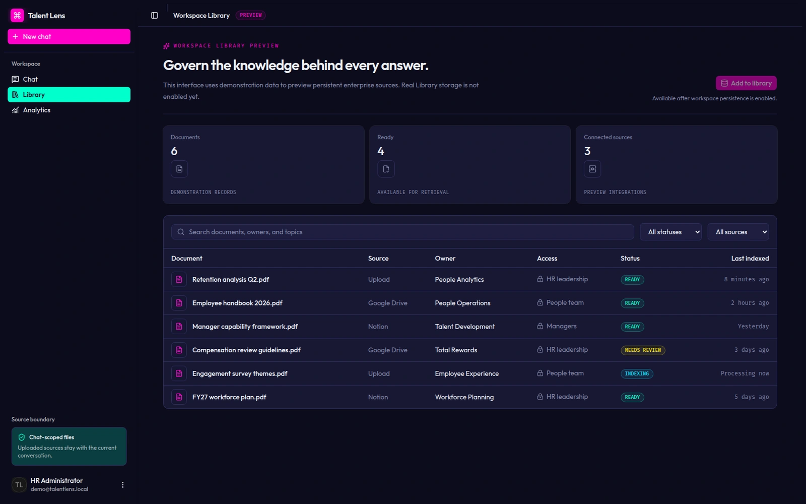
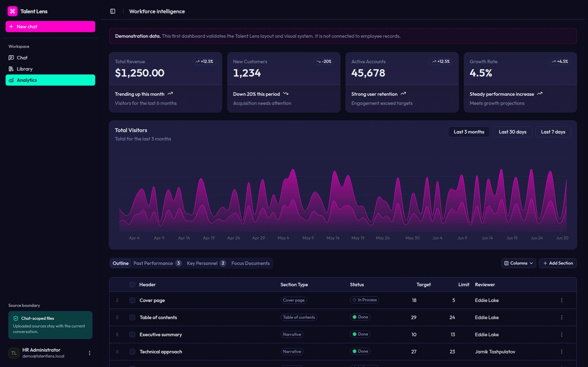
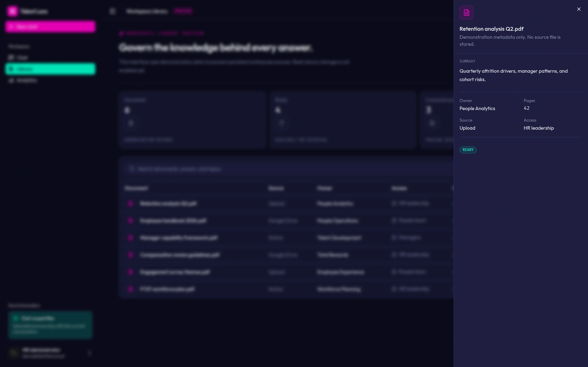
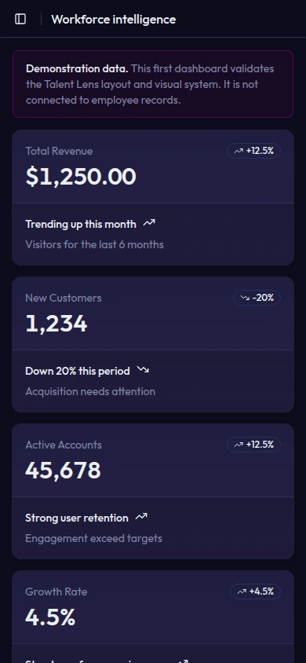

# Talent Lens

An interface prototype for a workforce dashboard and a searchable document library.

## Source and credits

Application prototype by Harshith Vaddiparthy, built on shadcn/ui and Base UI. The TweakCN cyberpunk preset supplies the visual foundation, with Outfit and Fira Code.

[Captured source revision](https://github.com/harshith-vaddiparthy/talent-lens/tree/c92ae8d0f255214c0ecf4b283b4f9a33fa7ca75a) · [MIT license](https://github.com/harshith-vaddiparthy/talent-lens/blob/c92ae8d0f255214c0ecf4b283b4f9a33fa7ca75a/LICENSE)

## Design decisions

- Use distinct color and type treatments for navigation, trends and document metadata.
- Keep demonstration and preview notices beside metrics, connector labels and storage controls.
- Open document metadata beside the searchable library so the list stays in context.

## Capture context

Bundled demonstration data; source and access labels are preview states.

The dashboard uses committed sample JSON. The Library uses six demonstration documents; connector/access labels are interface previews and persistent storage is disabled. The captures do not use employee records or fetch the sample documents.

## Run the captured interface

Use Node.js 22 and pnpm 10.15.0 in a fresh checkout pinned to the source revision. The dashboard and library can be inspected without provider services.

```sh
pnpm install --frozen-lockfile --ignore-scripts
pnpm build
pnpm start --hostname 127.0.0.1 --port 37623
```

Open `/dashboard` or `/library` directly. Follow the source README separately if you want to configure other product capabilities.

## Screens

### Workspace Library preview



[Original PNG](../public/ui-media/talent-lens-library-desktop.png)

### Demonstration dashboard



[Original PNG](../public/ui-media/talent-lens-dashboard-desktop.png)

### Demo document detail



[Original PNG](../public/ui-media/talent-lens-document-detail-desktop.png)

### Mobile demonstration dashboard



[Original PNG](../public/ui-media/talent-lens-dashboard-mobile.png)
