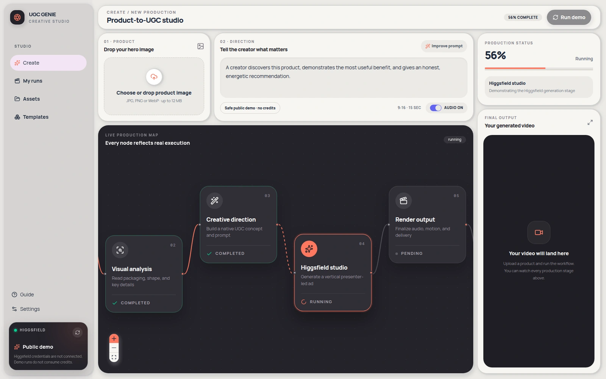
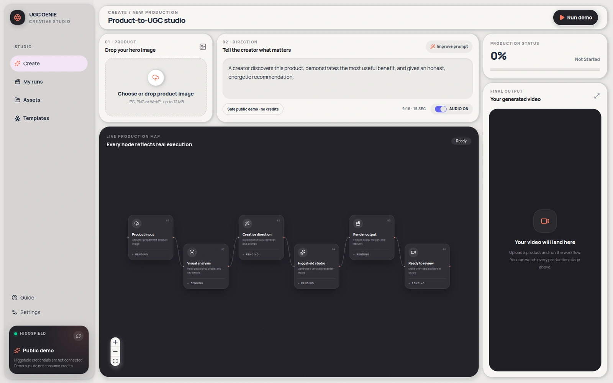
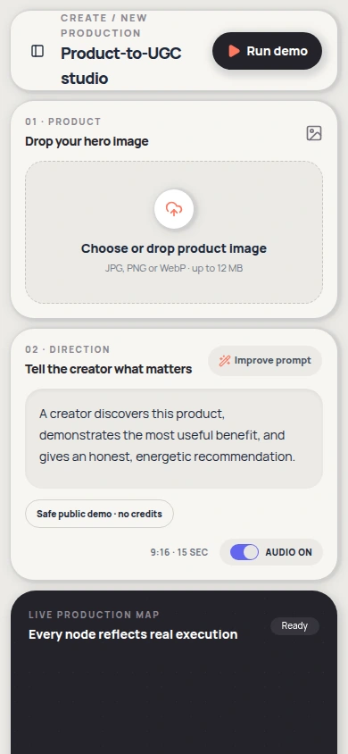

# UGC Genie

A node-based production workspace that makes product intake, creative direction and video-production stages understandable.

## Source and license

- Source: [UGC-dashboard](https://github.com/harshith-vaddiparthy/UGC-dashboard)
- Audited revision: [`274c42cc56864fb34c17b56e4743386aa4332e3f`](https://github.com/harshith-vaddiparthy/UGC-dashboard/commit/274c42cc56864fb34c17b56e4743386aa4332e3f)
- Project license: [MIT at the audited revision](https://github.com/harshith-vaddiparthy/UGC-dashboard/blob/274c42cc56864fb34c17b56e4743386aa4332e3f/LICENSE)
- Copyright notice in that license: 2026 Harshith Vaddiparthy.

Workflow composition and implementation by Harshith Vaddiparthy, using React Flow, shadcn/ui, Base UI and the tweakcn claymorphism theme.

## Design decisions

- Map product input, analysis, concept, generation, rendering and delivery onto ordered workflow nodes.
- Show each step’s status, progress and message instead of hiding the process behind one spinner.
- Keep product input, creative direction and output review alongside the workflow.

## Foundations

React Flow supplies the node-canvas foundation and shadcn/ui supplies interface primitives. The case highlights the application’s stage model, controls and progress presentation.

Underlying packages, icons and other third-party assets retain their own licenses and attribution. The gallery MIT license does not replace them.

## Safe local preview

Use a current supported Node.js LTS and pnpm. The repository includes pnpm-lock.yaml.

Run the source in a fresh checkout. Use sample files and demo data when sharing screenshots.

```bash
git clone https://github.com/harshith-vaddiparthy/UGC-dashboard.git
cd UGC-dashboard
git checkout 274c42cc56864fb34c17b56e4743386aa4332e3f
pnpm install --frozen-lockfile
UGC_RUNTIME_MODE=public-demo NEXT_PUBLIC_UGC_RUNTIME_MODE=public-demo pnpm dev
```

Set both demo-mode variables before starting the app. The client demo follows timed local workflow states, while the server demo branch avoids live Higgsfield generation. These are simulated progress states, not proof that a new video was generated. The bundled demo output references an external sample video; it is not original gallery media. Capture the interface and workflow state, rather than presenting that sample video as authored work. The public deployment is not linked here because its current live-provider state is not a safe screenshot demo.

## Capture context

Gallery captures must identify their source revision, capture date and whether example or simulated data is shown. Only reviewed application imagery belongs in this case. Source links remain pinned above so the design can be inspected independently.

<!-- gallery-captures -->
## Screens

Credit-free local demo with simulated workflow stages. Capture dates and source verification are recorded in the [capture manifest](../public/ui-media/capture-manifest.json).

### Simulated workflow detail



[Open the original screenshot](../public/ui-media/ugc-genie-workflow-zoom-desktop.png)

### Studio intake



[Open the original screenshot](../public/ui-media/ugc-genie-studio-desktop.png)

### Phone studio



[Open the original screenshot](../public/ui-media/ugc-genie-studio-mobile.png)
